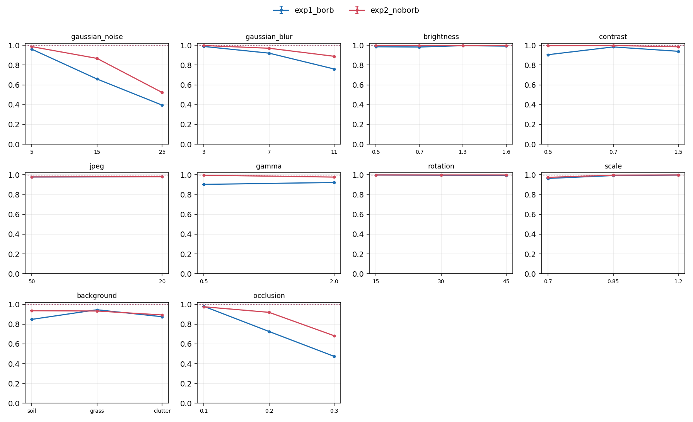

# Results summary

All numbers are test-set results of checkpoints selected by **validation** accuracy. Mean ± sample std over seeds. Accuracy in %.

## Data integrity (pHash dedup, group-aware 60/20/20 split)

**mangoleafbd**: input 4000, exact byte duplicates removed 21, identical-pHash (grouped) 247, kept 3979; near-duplicate pairs (≤4 bits) 319 → 280 multi-image groups covering 578 images (largest 4); cross-class near-duplicate pairs 8; split sizes {'train': 2394, 'val': 788, 'test': 797}.

**plantvillage15**: input 20639, exact byte duplicates removed 14, identical-pHash (grouped) 0, kept 20625; near-duplicate pairs (≤4 bits) 51 → 51 multi-image groups covering 102 images (largest 2); cross-class near-duplicate pairs 8; split sizes {'train': 12373, 'val': 4125, 'test': 4127}.

**web**: input 185902, exact byte duplicates removed 7694, identical-pHash (grouped) 3145, kept 178208; near-duplicate pairs (≤4 bits) 20188 → 7493 multi-image groups covering 20197 images (largest 57); cross-class near-duplicate pairs 5520; split sizes {'train': 142651, 'val': 17699, 'test': 17858}.

**web_v2**: input 422306, exact byte duplicates removed 65147, identical-pHash (grouped) 8946, kept 357159; near-duplicate pairs (≤4 bits) 60543 → 15668 multi-image groups covering 42323 images (largest 354); cross-class near-duplicate pairs 22684; split sizes {'train': 271601, 'val': 34101, 'test': 51457}.

**web_v2_stale**: input 422306, exact byte duplicates removed 65147, identical-pHash (grouped) 8946, kept 357159; near-duplicate pairs (≤4 bits) 60547 → 15672 multi-image groups covering 42331 images (largest 354); cross-class near-duplicate pairs 22680; split sizes {'train': 271610, 'val': 34019, 'test': 51530}.

**web_v3**: input 468102, exact byte duplicates removed 48964, identical-pHash (grouped) 15075, kept 419138; near-duplicate pairs (≤4 bits) 75422 → 22099 multi-image groups covering 58107 images (largest 354); cross-class near-duplicate pairs 27964; split sizes {'train': 321297, 'val': 40067, 'test': 57774}.

## exp1_borb vs exp2_noborb

| backbone        | paper (reported)   | exp1_borb test acc   | exp2_noborb test acc   |   Δ (pp) | exp1_borb macro-F1   | exp2_noborb macro-F1   | exp1_borb κ   | exp1_borb TTA   |
|:----------------|:-------------------|:---------------------|:-----------------------|---------:|:---------------------|:-----------------------|:--------------|:----------------|
| efficientnet_b3 | –                  | 99.76 (n=1)          | 99.76 (n=1)            |        0 | 99.68 (n=1)          | 99.75 (n=1)            | 0.9974 (n=1)  | 99.76 (n=1)     |

**Paired tests on identical test images** (b = only A correct, c = only B correct):

| backbone        |   seed |   acc_a |   acc_b |   diff | diff_ci        |   b |   c |   p_value | method         |
|:----------------|-------:|--------:|--------:|-------:|:---------------|----:|----:|----------:|:---------------|
| efficientnet_b3 |      0 |   99.76 |   99.76 |      0 | [-0.17, +0.17] |   6 |   6 |         1 | exact binomial |

## Segmentation method comparison (same backbone/recipe; paper Table 11 style)

| experiment   | method    | backbone        | val acc     | test acc    | macro-F1    | mask failure rate   |
|:-------------|:----------|:----------------|:------------|:------------|:------------|:--------------------|
| exp1_borb    | borb_plus | efficientnet_b3 | 99.88 (n=1) | 99.76 (n=1) | 99.68 (n=1) | 0.85%               |
| exp2_noborb  | none      | efficientnet_b3 | 99.85 (n=1) | 99.76 (n=1) | 99.75 (n=1) | –                   |

## Robustness (exp3_robustness)

Perturbations are applied to the raw test image; the BorB model segments the perturbed image. mCA = mean accuracy over all corruption conditions; rel. drop = (clean − mCA)/clean.

| backbone        | exp         | clean       | mCA         | rel_drop   | background   | brightness   | contrast    | gamma       | gaussian_blur   | gaussian_noise   | jpeg        | occlusion   | rotation    | scale       | plantdoc_all15   | plantdoc_overlap13   |
|:----------------|:------------|:------------|:------------|:-----------|:-------------|:-------------|:------------|:------------|:----------------|:-----------------|:------------|:------------|:------------|:------------|:-----------------|:---------------------|
| efficientnet_b3 | exp1_borb   | 99.76 (n=1) | 89.82 (n=1) | 9.96 (n=1) | 88.96 (n=1)  | 98.93 (n=1)  | 94.29 (n=1) | 91.33 (n=1) | 88.99 (n=1)     | 67.17 (n=1)      | 97.94 (n=1) | 72.65 (n=1) | 99.66 (n=1) | 98.49 (n=1) | 27.48 (n=1)      | 27.84 (n=1)          |
| efficientnet_b3 | exp2_noborb | 99.76 (n=1) | 94.64 (n=1) | 5.13 (n=1) | 92.05 (n=1)  | 99.78 (n=1)  | 99.36 (n=1) | 98.69 (n=1) | 95.25 (n=1)     | 79.25 (n=1)      | 98.03 (n=1) | 85.91 (n=1) | 99.86 (n=1) | 99.01 (n=1) | 26.75 (n=1)      | 26.93 (n=1)          |

McNemar per condition (seeds where BorB > no-BorB / seeds with p < 0.05):

| backbone        | perturbation   | severity   |   seeds |   borb_better |   sig |   median_p |
|:----------------|:---------------|:-----------|--------:|--------------:|------:|-----------:|
| efficientnet_b3 | background     | clutter    |       1 |             0 |     1 |   0.00066  |
| efficientnet_b3 | background     | grass      |       1 |             1 |     1 |   0.0034   |
| efficientnet_b3 | background     | soil       |       1 |             0 |     1 |   2.9e-50  |
| efficientnet_b3 | brightness     | 0.5        |       1 |             0 |     1 |   7.8e-12  |
| efficientnet_b3 | brightness     | 0.7        |       1 |             0 |     1 |   2.2e-12  |
| efficientnet_b3 | brightness     | 1.3        |       1 |             0 |     0 |   0.65     |
| efficientnet_b3 | brightness     | 1.6        |       1 |             0 |     1 |   0.0009   |
| efficientnet_b3 | clean          | 0          |       1 |             0 |     0 |   1        |
| efficientnet_b3 | contrast       | 0.5        |       1 |             0 |     1 |   7.2e-82  |
| efficientnet_b3 | contrast       | 0.7        |       1 |             0 |     1 |   2.9e-12  |
| efficientnet_b3 | contrast       | 1.5        |       1 |             0 |     1 |   3.4e-37  |
| efficientnet_b3 | gamma          | 0.5        |       1 |             0 |     1 |   3.7e-83  |
| efficientnet_b3 | gamma          | 2.0        |       1 |             0 |     1 |   7.1e-39  |
| efficientnet_b3 | gaussian_blur  | 11         |       1 |             0 |     1 |   3.3e-84  |
| efficientnet_b3 | gaussian_blur  | 3          |       1 |             0 |     1 |   1.5e-08  |
| efficientnet_b3 | gaussian_blur  | 7          |       1 |             0 |     1 |   7.6e-34  |
| efficientnet_b3 | gaussian_noise | 15         |       1 |             0 |     1 |   1.1e-163 |
| efficientnet_b3 | gaussian_noise | 25         |       1 |             0 |     1 |   2.3e-45  |
| efficientnet_b3 | gaussian_noise | 5          |       1 |             0 |     1 |   6.3e-18  |
| efficientnet_b3 | jpeg           | 20         |       1 |             0 |     0 |   0.71     |
| efficientnet_b3 | jpeg           | 50         |       1 |             0 |     0 |   0.93     |
| efficientnet_b3 | occlusion      | 0.1        |       1 |             1 |     0 |   0.12     |
| efficientnet_b3 | occlusion      | 0.2        |       1 |             0 |     1 |   9e-128   |
| efficientnet_b3 | occlusion      | 0.3        |       1 |             0 |     1 |   2.6e-108 |
| efficientnet_b3 | rotation       | 15         |       1 |             0 |     0 |   0.45     |
| efficientnet_b3 | rotation       | 30         |       1 |             0 |     1 |   0.035    |
| efficientnet_b3 | rotation       | 45         |       1 |             0 |     1 |   0.0044   |
| efficientnet_b3 | scale          | 0.7        |       1 |             0 |     1 |   0.00062  |
| efficientnet_b3 | scale          | 0.85       |       1 |             0 |     1 |   0.003    |
| efficientnet_b3 | scale          | 1.2        |       1 |             0 |     0 |   0.55     |

Share of Grad-CAM energy outside the leaf mask (lower = attends to the leaf):

| backbone        |   bg_energy_borb |   bg_energy_noborb |
|:----------------|-----------------:|-------------------:|
| efficientnet_b3 |           0.4622 |             0.5053 |

## Model cost

Latency: batch 1, device `mps`.

| backbone        |   params_m |   gflops |   latency_ms |
|:----------------|-----------:|---------:|-------------:|
| efficientnet_b0 |       4.85 |     0.77 |         5.85 |
| efficientnet_b3 |      10.72 |     1.92 |       163.57 |

## All experiments

| exp           | dataset        | backbone        |   seeds | val_acc     | test_acc    | f1_macro    |   epochs |   train_min |
|:--------------|:---------------|:----------------|--------:|:------------|:------------|:------------|---------:|------------:|
| exp1_borb     | plantvillage15 | efficientnet_b3 |       1 | 99.88 (n=1) | 99.76 (n=1) | 99.68 (n=1) |       30 |       694.3 |
| exp2_noborb   | plantvillage15 | efficientnet_b3 |       1 | 99.85 (n=1) | 99.76 (n=1) | 99.75 (n=1) |       30 |       645.3 |
| web_model_v3  | web            | efficientnet_b0 |       1 | 86.13 (n=1) | 88.49 (n=1) | 79.26 (n=1) |        4 |       360.2 |
| web_model_v3b | web            | efficientnet_b0 |       1 | 87.29 (n=1) | 89.47 (n=1) | 80.52 (n=1) |        4 |      1085.7 |
